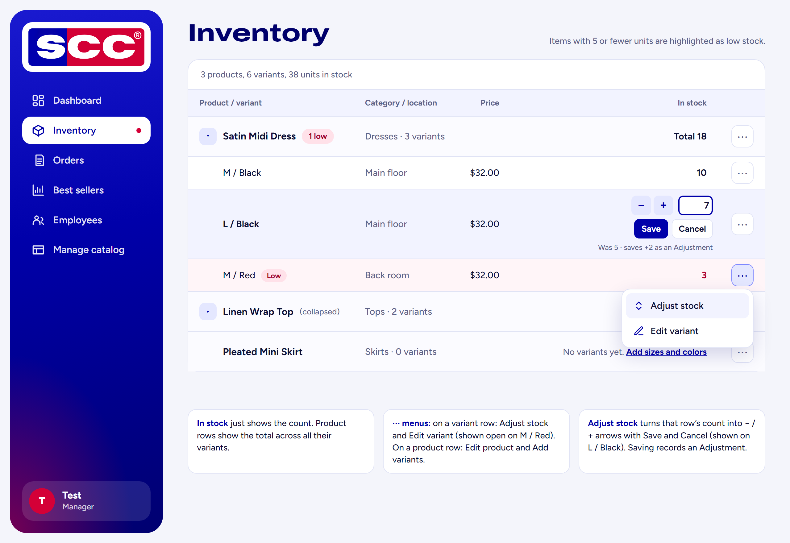
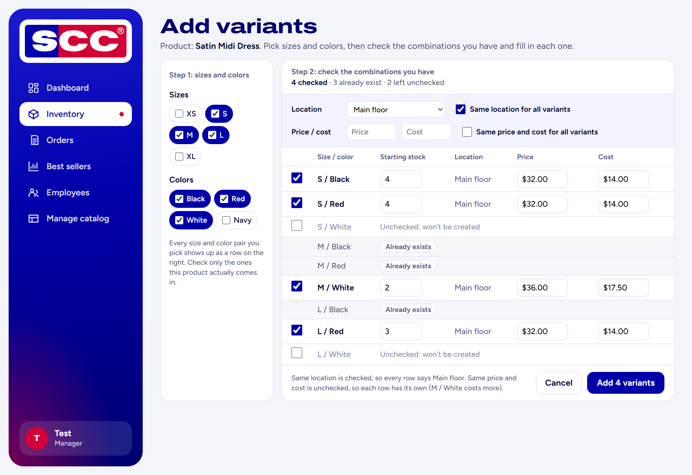
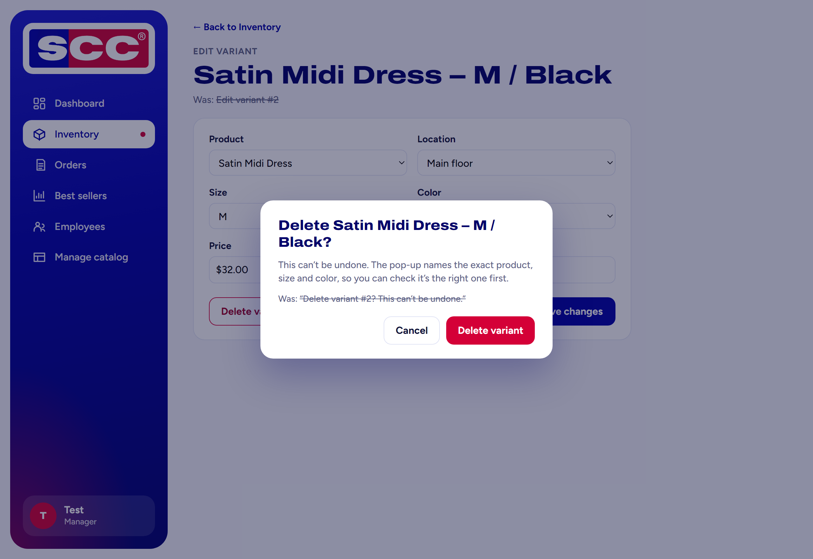
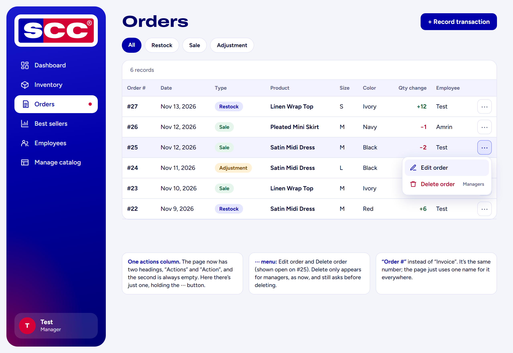
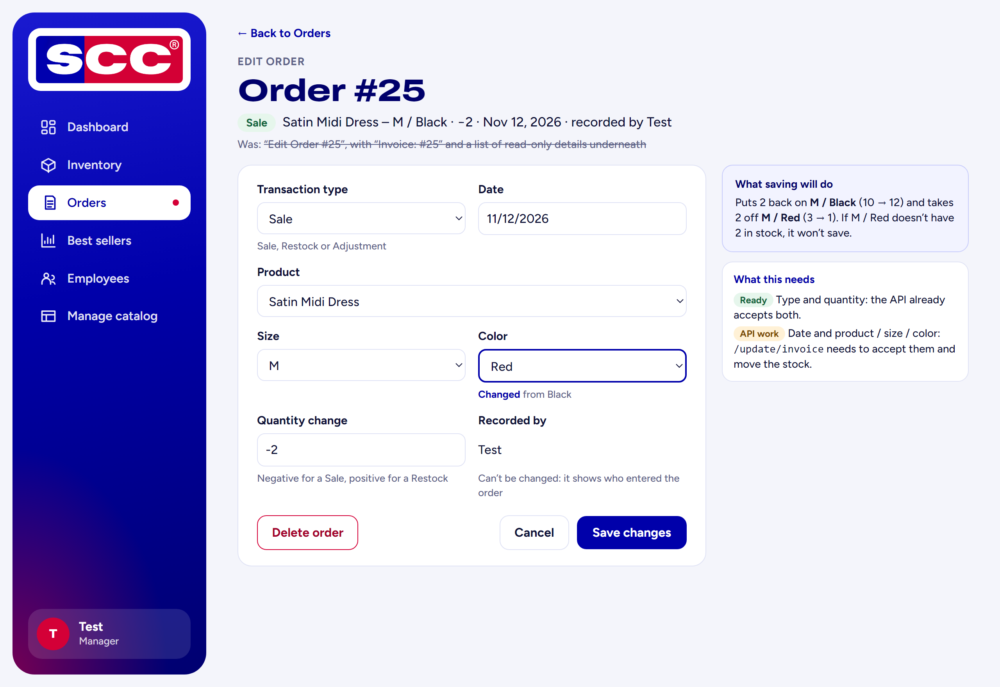
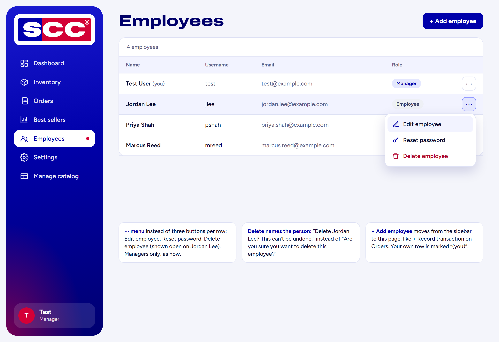
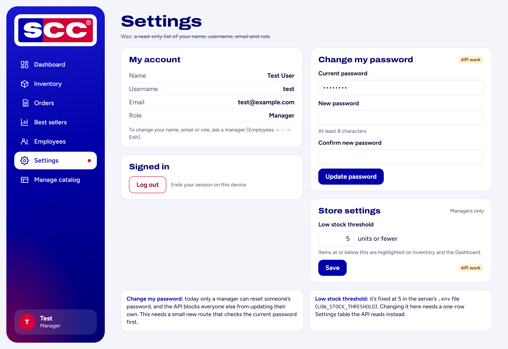
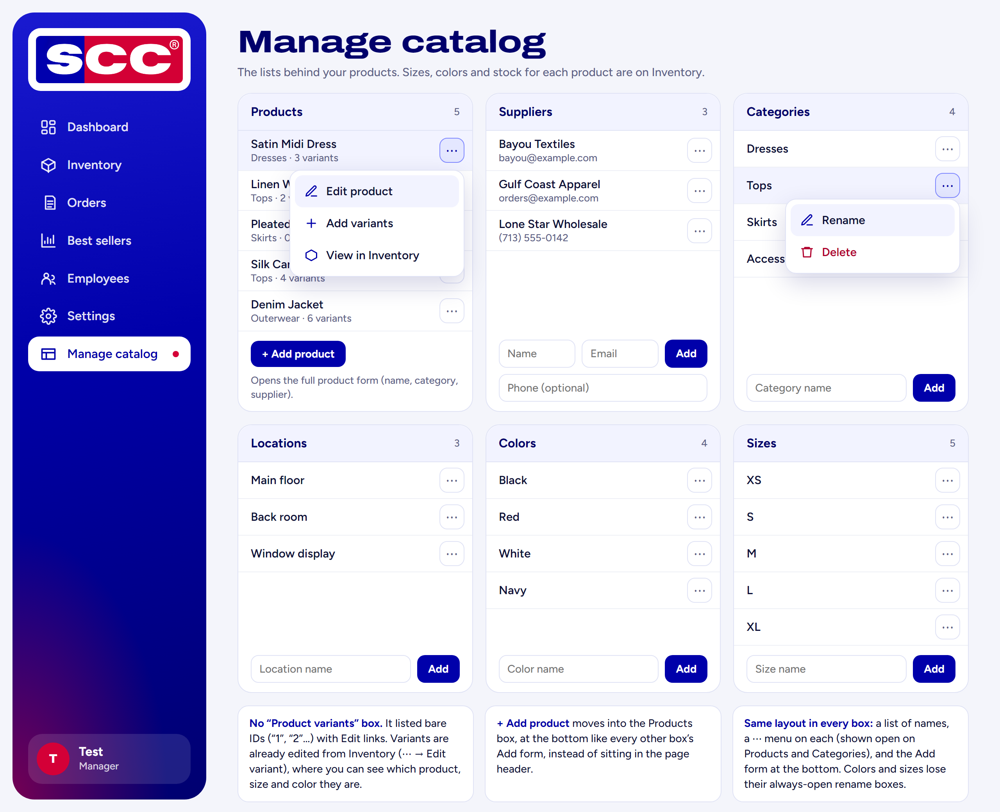

# Suggested page designs

These are **my suggestions (Bianca), not decisions.** This folder only has mockup images and notes. Use whatever helps, change anything, or skip any of it. The one exception is the empty column on the Orders page (section 4): that's a bug, not a design choice, so the same PR fixes it.

The mockups use made-up products, people and emails just to show the layout.

**The idea behind all of them.** When I went through the app as if I were the store owner, the same few things kept getting in the way:

1. **Records shown by ID number instead of by name.** "Variant #2", "Invoice #25" and a list of bare variant numbers don't mean anything to someone working in the store. They have to remember or look up what the number is, and that's how the wrong thing gets edited or deleted.
2. **Too many buttons on every row.** Edit / Reset password / Delete, or Edit product / Edit variant / a stock box with Save, repeated on every line. It makes tables wide and busy, and it's easy to click the wrong one.
3. **Things you can't actually do.** Order fields you can't correct, a Settings page with no settings, a password you can't change yourself.
4. **The same thing done differently on different pages.** Add buttons in different places, some lists with inline rename boxes and some with Edit links.

So the suggestions follow a few rules:

- **Show names, not IDs:** "Satin Midi Dress – M / Black", "Order #25 · Sale · Nov 12".
- **One ⋯ menu per row** holds that row's actions. Tables stay short and readable on a laptop or phone, and risky actions like Delete and Adjust stock take a deliberate click.
- **"+ Add …" goes in the same place everywhere:** a button at the top right of the page, or at the bottom of its box on Manage catalog.
- **Each thing is managed in one place:** variants on Inventory, lookups on Manage catalog, your own account on Settings.

Each section below lists **what's different**, **why**, and **what it would touch**. Most are front-end only; the ones that need API work are labelled.

---

## 1. Inventory: variants grouped under their product



**What's different**

- Each product gets a bold row with its category, how many variants it has, and **Total** stock. Its sizes and colors are listed underneath it. A "1 low" tag shows if any of them are low.
- The **In stock** column is just the number, right-aligned, so the counts line up.
- Each row has a **⋯ menu**:
  - product rows: *Edit product*, *+ Add variants*
  - variant rows: *Adjust stock*, *Edit variant*
- **Adjust stock** turns that row's count into `[−] [+] [count]`. Save and Cancel sit underneath, with a note like "Was 5 · saves +2 as an Adjustment". The number box stays where the count was, so it lines up with the other counts. Only one row is in adjust mode at a time.
- Optional: a ▸ / ▾ arrow to collapse a product to one line.
- A product with no variants still shows up, with "No variants yet. Add sizes and colors".

**Why**

- The owner thinks in products: "how many Satin Midi Dresses do we have, and in which sizes?" Right now that means finding every row for the dress and adding them up. With 20 products in 8 sizes and colors each, the page is a flat list of 160 rows. Grouping answers the question at a glance (R-02, R-11).
- Every row now repeats Edit product, Edit variant and a stock box with Save. It's clutter, and it's easy to click the wrong one: Edit product on a variant row edits the whole product.
- An always-open stock box on every row is the easiest place to change stock by accident, and every save creates an Adjustment invoice. Choosing *Adjust stock* first makes a change deliberate, and the − / + arrows make the usual small fixes a couple of clicks.

**What it would touch:** `inventory.ejs`, plus the `/inventory` route in `frontend/server.js` to sort the rows by product. Save would still use the existing `POST /inventory/:variantId/adjust` → `PUT /adjust/inventory`. No API changes.

---

## 2. Add variants: one row per size and color



**What's different**

- **Step 1:** checkbox chips for sizes and colors. These only decide which rows show up in step 2.
- **Step 2:** one row per size/color combination, each with a checkbox, **Starting stock**, **Location**, **Price** and **Cost**.
  - Only checked rows are created. Unchecked rows are greyed out with "Unchecked: won't be created".
  - Combinations that already exist say "Already exists" and have no checkbox.
- **"Same for all" shortcuts** above the rows (the fields come first, the checkbox on the right):

  ```
  Location      [Main floor     ▾]   ☑ Same location for all variants
  Price / cost  [Price]  [Cost]      ☐ Same price and cost for all variants
  ```

  - If one is checked, every row uses that value.
  - If it's unchecked, each row gets its own Location, or its own Price and Cost boxes.
- The button counts the checked rows, e.g. "Add 4 variants".

**Why**

- Almost every item comes in several sizes and colors, so adding a product is the most common setup task. Right now each submit creates one variant, so a dress in 3 sizes × 3 colors means filling out the form 9 times.
- Not every size comes in every color (a dress might only come in white in medium). That's why each combination gets its own checkbox instead of creating every combination automatically.
- Cost can differ between sizes and colors, so each row has its own price and cost. Nothing needs fixing afterwards one variant at a time.
- Duplicates are the biggest risk. Two "M / Black" rows for the same dress split its stock, so the count, the low stock warning and the best sellers report are all wrong for that item (R-12). Showing existing combinations as "Already exists" prevents that (R-03). The database could also get a unique rule on (Product_ID, Size_ID, Color_ID) as a backstop.

**What it would touch:** `newvariant.ejs` and its route in `frontend/server.js`. No API changes: for each checked row, Express makes the same calls the current page already makes (`POST /api/product_variants`, which now returns the new `Variant_ID`, then the inventory and starting-stock calls).

---

## 3. Edit variant: name the variant instead of its ID



**What's different**

- The heading says **"Satin Midi Dress – M / Black"** instead of "Edit variant #2".
- The delete pop-up says **"Delete Satin Midi Dress – M / Black?"** instead of "Delete variant #2?", and the save pop-up says "Save changes to Satin Midi Dress – M / Black?" instead of "Save changes to variant #2?".

**Why**

Nobody in the store knows variants by their database number. Naming the product, size and color lets them check it's the right one, especially before deleting something that can't be undone.

**What it would touch:** `edit-variant.ejs` only. The page already has the product, size and color lists for its dropdowns, so it can look up the names from them.

---

## 4. Orders: one actions column, with a ⋯ menu



**What's different**

- **One** actions column instead of two. Each row's ⋯ menu has *Edit order*, plus *Delete order* for managers only, as now. Delete still asks before deleting.
- The first column is called **"Order #"** instead of "Invoice".

**Why**

- **The double column is a bug.** PR #12 (Amrin) added an "Action" column with Edit and Delete, and PR #14 (Madison) added an "Actions" column with almost the same buttons. Both were merged the same night, and both headings were kept but only one set of buttons. So the table has 10 headings and 9 cells per row, and the last column is always empty. **This PR already fixes it** by deleting the extra `<th>Action</th>` line in `orders.ejs`; the "no orders" message already spans 9 columns, which is right now that the extra heading is gone. The ⋯ menu below is the optional part.
- The ⋯ menu matches Inventory and Employees, so every table in the app works the same way.
- "Order #" and "Invoice #" are the same number (an order *is* one row in the `Invoice` table). The page is called Orders, so using one word for it everywhere stops people wondering whether they're two different things.

**What it would touch:** `orders.ejs` only.

---

## 5. Edit order: say what the order is, and let more of it be corrected



**What's different**

- The heading is **"Order #25"** with a summary line underneath: "Sale · Satin Midi Dress – M / Black · −2 · Nov 12, 2026 · recorded by Test". It replaces "Edit Order #25" followed by "Invoice: #25" and a list of read-only details.
- More fields can be changed:

  | Field | Editable? | Needs |
  |---|---|---|
  | Quantity | Yes (already is) | — |
  | Transaction type | **Yes** | Front end only: the API already accepts `Transaction_Type_ID` |
  | Product / size / color | **Yes** | API work |
  | Date | Yes | API work |
  | Recorded by | No | — |

- A side box says what saving will do to stock, e.g. "Puts 2 back on M / Black (10 → 12) and takes 2 off M / Red (3 → 1)".

**Why**

- The commonest mistakes when recording a sale are picking the wrong size or color, or Sale instead of Restock. Right now only the quantity can be fixed, so the only way to correct anything else is to delete the order and record it again.
- **Type:** half-built already. `/update/invoice` accepts it, but the form never sends it. The sign check in `POST /orders/:id/edit` also needs to use the *new* type. Today it checks the quantity against the old type, so switching Sale → Restock would be rejected.
- **Product / size / color:** changing the item means putting the stock back on the old variant and taking it off the new one, after checking the new one has enough. `/update/invoice` doesn't do that yet. Until it does, delete-and-record-again still works, since delete already reverses the stock correctly.
- **Date:** a wrong date puts the sale in the wrong period on the best sellers report.
- **Recorded by stays read-only** because it's the record of who entered it.
- The side box explains the stock change before it happens, so nobody is surprised when two counts move.

**What it would touch:** `edit-order.ejs` and `POST /orders/:id/edit` for type. Date and item also need `/update/invoice` in `backend/api.py`.

---

## 6. Employees: actions in a ⋯ menu



**What's different**

- Each row's ⋯ menu has *Edit employee*, *Reset password* and *Delete employee*, managers only as now. This replaces three buttons on every row.
- The delete pop-up names the person: "Delete Jordan Lee? This can't be undone." instead of "Are you sure you want to delete this employee?"
- **+ Add employee** is a button on this page, like + Record transaction on Orders, instead of a sidebar link.
- Your own row says "(you)".

**Why**

- Three buttons per row makes the table wide, and Delete sits right next to Edit. Putting them behind ⋯ makes deleting someone a deliberate choice, and it matches the other tables.
- "Delete this employee?" doesn't say who. If you clicked the wrong row, the pop-up should make that obvious.
- The sidebar should be places, not actions. Adding an employee belongs on the Employees page, which is how Orders and Manage catalog already work.
- "(you)" stops a manager from accidentally editing or deleting their own account.

**What it would touch:** `employees.ejs`, and `nav.ejs` to drop the Add employee link. No API changes.

---

## 7. Settings: add real settings



**What's different**

- **My account:** your details, read-only, with a note that a manager changes them.
- **Signed in:** a Log out button.
- **Change my password:** current password, new password, confirm. *(API work)*
- **Store settings,** managers only: the **low stock threshold**. *(API work)*

**Why**

- The page is called Settings but only shows your profile, so there's nothing to set.
- **Changing your own password** is the most basic account setting, and right now nobody can do it. Only a manager can reset someone *else's* password, and the API blocks non-managers from `/update/employee`. That needs a small new route that checks the current password first, so it's safe for any signed-in user.
- **Low stock threshold** is in the requirements (it replaces "reorder threshold") but it's fixed at 5 in the server's `.env` file (`LOW_STOCK_THRESHOLD`). Only someone with server access can change it. Making it a setting needs a one-row Settings table that the API reads instead.
- **Log out** fits here, and it's where the app already sends you: `GET /logout` redirects to `/settings`.

**What it would touch:** `settings.ejs` and its routes. The password and threshold parts also need API routes, and the threshold needs a small table.

---

## 8. Manage catalog: same layout in every box, no variants box



**What's different**

- **The "Product variants" box is removed.**
- **+ Add product** moves from the page header into the bottom of the Products box. It still opens the full product form.
- **Every box works the same way:** a list of names, a ⋯ menu on each, and the Add form at the bottom.
  - Products show their category and variant count underneath the name. Their menu has *Edit product*, *Add variants* and *View in Inventory*.
  - Colors and sizes lose their always-open rename boxes; *Rename* goes in the ⋯ menu.
- The heading is "Manage catalog", matching the sidebar, instead of "Manage Catalogue".

**Why**

- **The variants box doesn't add anything.** It lists bare IDs ("1", "2"…) with Edit links, so you can't tell which variant you're opening. Variants are already edited from Inventory (⋯ → Edit variant), where you can see the product, size and color. With the Inventory and Add variants changes, everything to do with variants happens in one place.
- **Add product** was the only Add that wasn't in its box. Moving it there makes the page consistent: you look in the box for the thing you want to add.
- **One layout for every box** means you learn it once. Always-open rename boxes on colors and sizes look like forms you're meant to fill in, and they make those boxes much taller than the others.
- **Only real actions in each menu:** suppliers, categories and locations already have edit/delete pages; colors and sizes can only be renamed.

**What it would touch:** `manage.ejs`, and the `/manage` route can stop fetching `/api/product_variants`. No API changes.
